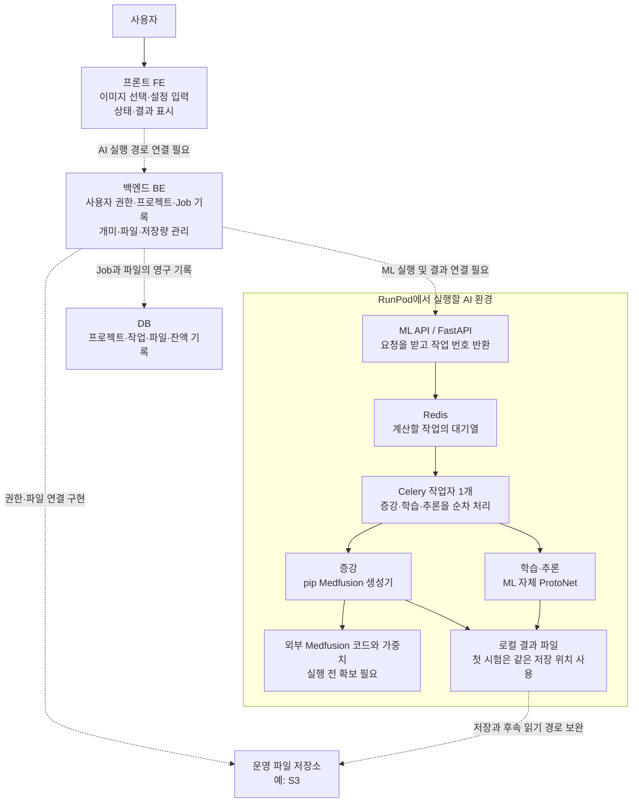
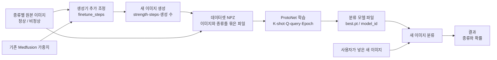
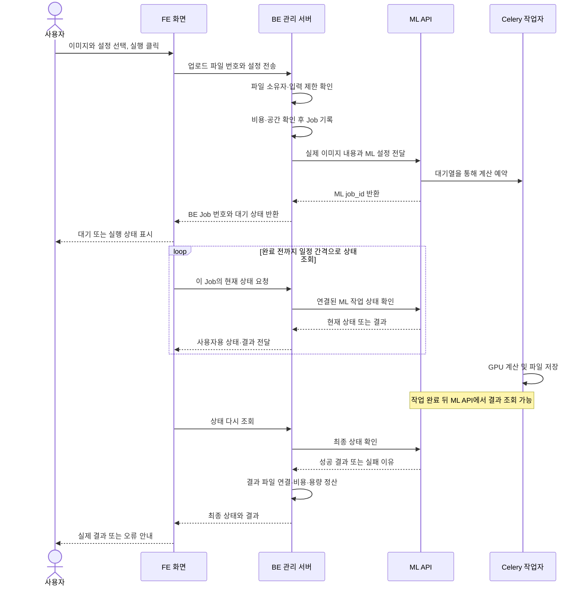
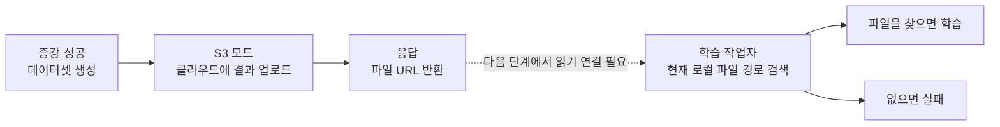

# BIFUSION 설계도 — 화면에서 AI 결과까지

이 문서는 2026-10-12 조사 기준이다. 설계도마다 **현재 확인한 구조**인지, **앞으로 연결할 설계안**인지 표시했다.

처음에는 1번과 2번을 보면 된다. 3번은 “실행 버튼을 눌렀는데 왜 기다려야 하는가?”, 4번은 “왜 파일 전달이 중요한가?”를 설명한다.

## 1. 전체 서비스 구조 — 연결할 목표와 현재 내부 구조

**읽는 법:** 실선은 확인한 프로그램 내부의 관계 또는 사용자의 화면 접근이다. 점선은 AI 서비스 전체 연결에서 보완할 부분이다. RunPod 박스는 앞으로 구성할 실행 환경이며 지금 배포돼 있다는 뜻은 아니다.

- **DB(데이터베이스):** “누가 어떤 프로젝트에서 어떤 작업을 했는가?”처럼 오래 보관할 기록을 저장한다.
- **Redis:** 계산할 작업을 기다리게 하는 대기열과 임시 결과 보관에 쓰인다.
- **Celery:** 대기열에서 작업을 가져와 실제 계산을 수행하는 프로그램이다.
- **FastAPI:** ML의 API 접수 기능을 작성하는 Python 도구다.
- **가중치(Weights):** 모델이 학습한 숫자들이다. 코드가 계산 방법이라면 가중치는 학습된 내용이다.

이 설계에서 개미와 저장 용량을 ML이 판단하게 하지 않는다. 사용자의 권한·잔액·프로젝트를 알고 있는 BE가 먼저 확인하고, ML은 승인된 계산을 맡는다.

## 2. 이미지·모델이 넘어가는 흐름 — ML 코드에 있는 처리

**데이터셋(Dataset)**은 학습에 사용할 자료 묶음이다. **NPZ**는 여기서 이미지 숫자와 라벨을 함께 저장하는 파일 형식이다. **라벨(Label)**은 정상/비정상 같은 정답 종류를 말한다.

**model_id**는 학습된 모델을 찾기 위한 식별자다. FE에서 예시 모델명을 보내는 대신 실제 학습 결과의 번호를 보내야 한다.

같은 “학습”이라도 두 곳의 목적이 다르다:
- 생성기 추가 조정은 원본에 맞는 변주 이미지를 만들기 위해 한다.
- ProtoNet 학습은 이미지의 종류를 구분하기 위해 한다.

그림의 파일 전달은 현재 로컬 경로에서의 코드 관계다. S3에 저장한 결과를 다음 단계가 읽는 경로는 보완해야 한다. 전체 서비스를 새로고침 후 이어서 쓰게 하려면 BE가 이 데이터셋·모델 번호를 Job과 연결해 저장해야 한다.

## 3. 실행 버튼을 눌렀을 때 — BE 연동 제안

이 그림은 **앞으로 연결할 API 흐름**이다. FE·BE 경로가 현재 모두 구현됐다는 뜻은 아니다.

이렇게 바로 작업 번호를 반환하고 계산을 나중에 끝내는 방식을 **비동기 처리**라고 한다. 오래 걸리는 계산 동안 화면의 요청 하나를 계속 붙들고 있지 않아도 된다.

**폴링(Polling)**은 “끝났나요?”를 일정 간격으로 다시 묻는 것이다. 회의에서 진행률 바를 제거하기로 해도 폴링과 상태 표시는 필요하다.

**BE Job 번호와 ML job_id**는 서로 역할이 다르다. BE 번호는 서비스에 남길 작업 기록이고, ML 번호는 GPU 계산을 찾는 번호다. 둘을 연결해야 새로고침 후에도 올바른 작업을 조회한다.

중복 클릭으로 같은 계산이 두 번 시작되지 않게 처리해야 한다. 이를 **멱등성(Idempotency)**이라고 한다. 예를 들어 같은 요청 번호로 재시도하면 새 작업을 또 만들지 않고 기존 작업 번호를 돌려주는 방식이다.

## 4. 왜 S3 업로드만으로 끝나지 않는가? — 현재 문제

**S3**는 클라우드 파일 보관함이다. **로컬 파일**은 지금 계산 중인 서버의 디스크에 있는 파일이다. 서로 다른 장소다.

파일을 클라우드에 올렸어도 학습 프로그램이 서버 디스크만 찾으면 그 파일을 사용하지 못한다. 운영에서는 다운로드해서 읽거나 저장소에서 직접 읽는 경로를 마련해야 한다. “저장 성공”과 “다음 단계에서 사용 가능”을 함께 시험해야 한다.

**임시 다운로드 URL**은 일정 시간이 지나면 만료된다. 파일을 오래 찾으려면 URL 자체보다 저장소의 파일 키와 소유자 정보를 기록하고, 필요할 때 새 URL을 발급한다.

첫 RunPod 시험은 API와 작업자가 같은 결과 디렉터리를 사용하는 방식으로 흐름을 확인한다. 운영용 저장소 전환은 그 다음 검증한다.

## 5. 포크 레시피 실행 — 회의 결정을 반영할 흐름

현재 화면·서버를 이 흐름으로 연결하는 작업이 필요하다. 특히 “레시피 가져오기”와 “GPU 계산 실행”은 다른 사건이므로 비용과 보상 조건도 구분해야 한다.

작업에는 당시의 최종 설정을 복사해 저장한다. 이것을 **스냅샷(Snapshot)**이라고 한다. 예를 들어 원본 레시피의 steps가 나중에 50에서 100으로 바뀌어도 이미 실행한 작업은 50으로 했다는 기록이 남아야 한다.

## 6. 이 설계를 팀에 설명하는 한 문장

“FE에서 원본과 설정을 보내면 BE가 권한·비용·파일을 확인하고, ML이 GPU 계산을 실행합니다. BE는 작업 번호와 결과를 저장하고 FE는 실제 상태·결과를 보여줍니다. 현재는 ML 내부 코드가 있고, 서비스 전체를 연결하는 작업과 실제 GPU 시험이 남아 있습니다.”
