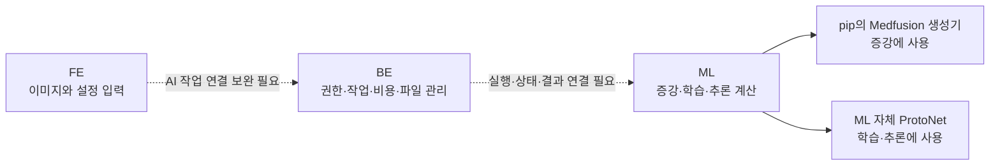

# BIFUSION 이해하기 — 프론트 담당자를 위한 안내

> **이 문서의 목표:** “내 화면에서 무엇을 입력하고, 어느 서버가 처리하며, 나는 무엇을 수정해야 하는가?”를 설명한다.
>
> 기준은 2026년 10월 12일에 확인한 코드다. **현재 구현**, **추가로 필요한 연결**, **아직 합의하지 않은 정책**을 구분해서 읽으면 된다.

## 먼저 이 순서로 읽기

| 지금 필요한 것 | 읽을 자료 |
|---|---|
| 전체 상황과 내가 해야 할 일 | **이 문서** |
| 서버들이 어떻게 연결되는지 | [구조·처리 흐름 설계도](ARCHITECTURE.md) |
| 팀원에게 무엇을 요청할지 | [백엔드 요청서](BACKEND_REQUEST.md) |
| RunPod에서 어떻게 시험할지 | [RunPod 실행 안내](RUNPOD.md) |
| 정확한 코드 근거와 세부 문제 | [상세 기술 조사](TECHNICAL_DETAILS.md) |

처음부터 모든 설정을 이해할 필요는 없다. **증강 → 학습 → 추론의 차이와, FE·BE·ML의 역할**부터 이해하면 나머지는 연결된다.

---

## 1. 우리 서비스에서 AI는 무엇을 하는가?

사용자가 가진 소량의 이미지를 바탕으로 실험용 데이터를 만들고, 그 데이터로 분류 모델을 학습시킨 다음, 새 이미지를 분류하는 흐름이다.

이 그림은 서비스가 완성됐을 때 사용자가 경험할 흐름이다. ML 내부 처리 코드는 있지만, FE·BE를 통한 전체 연결에는 추가 작업이 필요하다.

**증강(Augmentation)**은 이미지를 늘리는 단계다. 정상 5장·비정상 5장을 올리고 “클래스당 10장 생성”을 요청하면 새 이미지가 두 종류 합계 20장 추가된다. 클래스는 여기서 정상/비정상처럼 구분하는 종류를 뜻한다.

**학습(Training)**은 구분하는 기준을 만드는 단계다. 증강은 이미지를 만들고, 학습은 이미지의 종류를 구분하는 모델을 만든다. 이 둘은 서로 다른 계산이다.

**추론(Inference)**은 만들어진 모델을 사용하는 단계다. 새 이미지를 넣으면 NORMAL/ANOMALY와 확률을 반환한다. 이 값만으로 실제 의료 진단의 정확성이 입증되는 것은 아니다.

**레시피(Recipe)**는 실험 설정을 저장한 기록이다. 예를 들어 “변화 강도 0.3, 생성 단계 50, 클래스당 10장”을 묶어서 다시 사용할 수 있게 한다. 레시피 설정을 복사해도 실제 실행에 사용할 원본 이미지와 프로젝트는 선택해야 한다.

## 2. FE·BE·ML은 어떤 역할을 나눠 갖는가?

| 이름 | 쉬운 설명 | BIFUSION에서 맡을 일 |
|---|---|---|
| FE / 프론트엔드 | 사용자가 보는 화면 | 이미지 선택, 설정 입력, 실행 요청, 상태·결과 표시 |
| BE / 백엔드 | 사용자의 요청과 서비스 기록을 관리하는 서버 | 권한, 프로젝트, 작업 기록, 파일, 개미, 저장 용량 |
| ML / AI 서버 | AI 계산을 실행하는 서버 | 이미지 생성, 분류 모델 학습, 새 이미지 분류 |
| Bifusion_pip | ML이 가져다 쓰는 Python 코드 묶음 | 웹 경로에서는 Medfusion 이미지 생성기를 제공 |
| RunPod | GPU 컴퓨터를 빌려 쓰는 서비스 | ML 서버와 계산 프로그램을 실행할 장소 |

**GPU**는 이미지 생성·학습에 필요한 많은 계산을 빠르게 수행하는 장치다. RunPod를 구매한다는 것은 이런 장치가 달린 컴퓨터를 빌리는 것이다.

**API**는 프로그램끼리 요청하고 답을 받는 통로다. FE가 “학습 시작”을 요청하고 BE가 작업 번호를 돌려주는 것도 API 통신이다.

**DTO**는 그 통로에 어떤 이름과 형식의 값을 담을지 정한 틀이다. 예를 들어 화면의 “생성 단계 50”을 ML이 이해하는 `steps: 50`으로 보내야 한다. **API 주소가 존재해도 값의 이름·형식이 틀리면 설정이 적용되지 않을 수 있다.**

**실선은 확인한 ML 내부 호출 관계, 점선은 추가 연결이 필요한 서비스 관계**다. 이 그림은 서비스의 기존 모든 API가 미연동이라는 뜻이 아니다. AI 작업 경로에 한정한다.

**ProtoNet**은 각 종류의 대표적인 특징과 새 이미지의 특징을 비교해 분류하는 방식이다. 코드 전체를 이해하지 않아도 “증강용 모델과 분류용 모델이 다르다”는 점은 알아두면 좋다.
ㄷㄴㅇㅈ34ㄱ2ㅂ
## 3. 현재 어디까지 됐고, 무엇이 남았는가?

| 부분 | 확인한 상태 | 이것이 의미하는 것 |
|---|---|---|
| ML 증강·학습·추론 API | 코드 존재 | 실제 GPU·모델 파일로 실행 시험 필요 |
| 최신 증강·학습 설정 전달 | ML 코드에 반영 | FE와 BE도 같은 설정 이름으로 맞춰야 함 |
| FE AI 화면 | 화면과 모의 동작 존재 | 실패 시 가짜 작업으로 넘어가는 경로, 예시 결과를 실제 결과로 교체해야 함 |
| BE AI Job 실행 연결 | 조사한 JobController에는 댓글 기능만 확인 | 실행·상태 조회·결과 저장 경로를 팀과 구현해야 함 |
| 이미지 제한 | 배포 문서에 숫자는 있음 | 실제 서버가 강제하지 않아 검증 구현 필요 |
| S3 결과 저장 | 업로드 경로 존재 | 이후 학습·추론이 그 파일을 읽는 경로도 연결해야 함 |
| 개미와 전문가 보상 | 기존 검수 포인트 처리 일부 존재 | 새 Job 과금·충전·포크 보상 정책까지 완료됐다는 뜻은 아님 |

**Job(잡)**은 사용자가 실행한 작업 한 건이다. 증강 한 번, 학습 한 번, 추론 한 번이 각각 Job이 될 수 있다. 프로젝트는 여러 Job을 담는 공간이다.

ML API가 코드에 있다는 것은 “접수할 기능이 작성돼 있다”는 뜻이다. 실제 서버에서 모델이 로딩되고 GPU 계산이 성공하는지는 별도의 확인이다. 이번 조사는 코드·요청 검증·전달 경로까지 확인했고, RunPod GPU 실행은 아직 하지 않았다.

## 4. 팀원이 보낸 시안은 어떻게 활용하면 되는가?

`bifusion_param_mockup.html`은 최신 설정 방향을 잘 반영했다. 실제 업로드·API 호출 기능은 없는 화면 시안이므로, 입력 항목과 설명을 정하는 기준으로 활용한다.

### 증강 화면

| 화면 이름 / 실제 요청 이름 | 의미 | 현재 기본값·조치 |
|---|---|---|
| 클래스당 추가 생성 수 / `num_samples_per_class` | 정상·비정상 각각 몇 장을 새로 만들지 | 10 → 합계 새 이미지 20장 |
| 원본 변화 강도 / `strength` | 원본을 얼마나 바꿀지 | 0.3, 허용 범위 0~1 |
| 추가 학습 횟수 / `finetune_steps` | 생성기를 업로드 이미지에 맞춰 조정하는 반복 횟수 | 서버 기본 400, 배포 설정으로 바뀔 수 있음 |
| 생성 단계 / `steps` | 이미지를 만들어 가는 계산 단계 수 | 서버 기본 50 |
| 시드 / `seed` | 무작위 계산의 시작값 | 선택값, 기록 필요 |

**파인튜닝(Fine-tuning)**은 이미 학습된 모델을 내 이미지에 맞게 추가 조정하는 것이다. 이미지 생성 전에 하는 이 조정과, 다음 페이지의 분류 모델 학습은 별개다.

**시드(Seed)**를 같게 하면 결과를 재현하기 쉬워진다. 그러나 모델 파일·환경·계산 조건까지 영향을 주므로 “항상 같은 이미지가 나옵니다”라고 보장하지 않는다.

시안에서 바꿀 문구:
- “원본 충실도” → **“원본 변화 강도”**. 값이 높을수록 변화가 커지는 방향이다.
- “값이 높을수록 품질이 오릅니다” → **“계산 횟수를 조절하며, 처리 시간이 늘 수 있습니다.”**
- “동일한 이미지를 다시 생성합니다” → **“같은 시드와 설정으로 결과를 재현하기 쉽게 합니다.”**
- “Support 데이터 업로드” → **“증강할 원본 이미지 업로드”**.

이전 증강 요청의 `sampling_steps`, `guidance_scale`, `model_name`을 최신 ML에 그대로 보내면 일부 값은 오류 없이 무시될 수 있다. 특히 `guidance_scale` 숫자를 `strength`에 그대로 옮기면 안 된다. 의미와 범위가 다르다.

### 학습 화면

| 화면 이름 / 실제 요청 이름 | 쉬운 설명 | 기본값 |
|---|---|---|
| 증강 데이터 / `dataset_id` | 완료된 증강 자료를 가리키는 번호 | 실제 결과에서 선택 |
| K-shot / `k_shot` | 학습 사례마다 종류별로 참고하는 이미지 수 | 5 |
| Epoch / `epochs` | 큰 학습 반복 단위 | 30 |
| Q-query / `q_query` | 한 사례에서 분류 연습에 사용하는 종류별 이미지 수 | 5 |
| 에포크당 에피소드 / `episodes_per_epoch` | 한 Epoch 안에서 학습 사례를 구성하는 횟수 | 10 |
| 시드 / `seed` | 자료를 뽑는 무작위 계산의 시작값 | 42 |

**Support**는 참고 자료, **Query**는 그 참고 자료로 맞혀 보게 하는 이미지다. **Episode**는 이 두 자료를 뽑아 만든 학습 사례 한 번이다.

예를 들어 K-shot=3, Q-query=5라면, 정상·비정상 각각 참고 이미지 3장과 연습 이미지 5장을 뽑아 하나의 사례를 구성한다. 이 사례를 Epoch당 10번 구성하는 식이다. 자료가 부족하면 현재 코드가 중복 추출할 수 있으므로 선택 가능한 값과 최소 데이터 수를 서버에서 검증해야 한다.

Q-query는 **이미 있는 데이터셋 안에서 뽑는 수**다. 사용자가 Query 파일을 별도로 업로드하는 항목으로 만들지 않는다. 외부 이미지를 올려 정확도를 평가하는 기능은 후속 작업이다.

시안은 3-shot이 선택돼 있고 ML 기본값은 5다. 둘 중 하나를 제품 기본값으로 정해 명시적으로 보내면 된다.

### 추론 화면

학습이 완료된 실제 `model_id`와 새 이미지 내용 `images_base64`를 보내야 한다. 응답의 분류 결과와 확률을 화면에 표시한다.

**Confidence**는 모델이 해당 분류에 부여한 점수다. “confidence 90%”를 “의료적으로 90% 정확하다”는 뜻으로 설명하지 않는다.

## 5. 이미지 제한은 왜 장수만 정하면 안 되는가?

현재 FE는 종류별 최소 5장을 요구한다. 배포 문서는 종류별 최대 업로드 10장·최대 생성 100장을 적었지만, 실제 ML 요청 검증에서는 이 최대값이 강제되지 않는다.

| 결정할 것 | 예시 | 필요한 이유 |
|---|---|---|
| 장수 | 종류별 최소·최대 몇 장 | 너무 많은 계산 방지 |
| 파일당 용량 | 장당 몇 MB | 큰 파일 전송 제한 |
| 전체 전송량 | 한 요청에 몇 MB | 여러 파일 합계도 제한 |
| 픽셀 크기 | 최대 가로·세로/총 픽셀 | 압축 파일은 작아도 열었을 때 메모리가 클 수 있음 |
| 형식 | JPG·PNG 등 | 지원하지 않는 파일을 미리 안내 |
| 리사이즈 방식 | 정사각형으로 변경/비율 유지 | 중요한 이미지 정보가 왜곡될 수 있음 |

현재 BE의 일반 파일 업로드 설정은 장당 10MB·한 요청 합계 50MB다. 10MB 파일 20장을 한 번에 보내면 200MB이므로 맞지 않는다. FE의 업로드 묶음과 BE 제한을 함께 정해야 한다.

**Base64**는 이미지 파일을 API에 넣기 위해 문자열로 표현하는 방식이다. 전송량이 대략 4/3로 늘어난다. 현재 ML은 이 문자열 배열을 받는다. FE가 파일 번호만 보내는 방식으로 바꾸려면 BE가 파일을 읽어 ML 입력으로 변환해야 한다.

현재 ML은 원본을 128×128로 줄이고 생성 과정에서 다시 키웠다가 128×128 결과를 만든다. 원본의 세부 정보가 복원되는 것은 아니므로, 해상도·비율 처리 정책도 확인해야 한다.

## 6. 백엔드에는 무엇을 요청하면 되는가?

자세한 요청은 [백엔드 요청서](BACKEND_REQUEST.md)에 있다. 우선 아래 여섯 가지를 이야기하면 된다.

1. **이미지 전달:** 누가 올린 파일인지 확인하고, 실제 이미지를 ML로 넘겨 주세요.
2. **설정 일치:** 최신 ML 필드에 맞게 DTO와 레시피 저장 형식을 바꿔 주세요.
3. **작업 기록:** BE 작업 번호와 ML 작업 번호를 연결해 주세요.
4. **상태·결과 조회:** 새로고침 후에도 성공/실패와 실제 결과를 볼 수 있게 해 주세요.
5. **다운로드·삭제:** 결과 파일을 사용자 권한에 맞게 다운로드하고, 삭제 성공 뒤 용량을 줄여 주세요.
6. **개미·저장량:** 실행 전 잔액과 공간을 확인하고, 중복 차감·초과 실행을 막아 주세요.

**S3**는 클라우드에 파일을 보관하는 저장소다. 현재 ML에는 파일을 S3로 올리는 코드가 있지만 다음 학습·추론은 로컬 파일을 찾는다. 따라서 “S3 설정을 켰다”만으로 증강→학습→추론 파일 전달이 완성되지는 않는다.

## 7. 회의 결정은 화면에 어떻게 반영하는가?

| 결정 | 화면·서비스에서 할 일 |
|---|---|
| 진행률 바 우선 제거 | %와 바는 빼고 대기/실행/성공/실패는 표시 |
| 프로젝트 개수 무제한 | 프로젝트 수 제한을 요금 정책에 다시 넣지 않음 |
| 저장 용량 고정 | 실제 사용량과 한도를 BE에서 받아 표시 |
| Job별 개미 사용 | 실행 전 비용 안내, 실행 후 실제 차감 내역 |
| 포크 레시피에서 증강 | 내 프로젝트·원본 선택 → 설정 검토 → 실행 |
| 기타 화면 불일치는 나중에 | 예시 점수·가짜 성공은 먼저 정리하고 추가 그래프는 후순위 |

**포크(Fork)**는 다른 사람의 레시피를 내 사본으로 가져오는 것이다. 사본의 설정을 바꿔 실행할 수 있어야 한다.

개미는 서비스에서 사용할 크레딧이다. Job 삭제로 저장량이 줄어드는 것과 이미 쓴 GPU 비용을 환급하는 것은 별도 정책이다. 고정 용량이 사용자별인지 팀별인지도 아직 합의해야 한다.

기존 BE에는 검수 요청 시 포인트 차감과 검수 완료 시 전문가에게 보상의 90%를 지급하는 코드가 있다. 이 처리와 새 개미 정책이 맞는지 확인해야 한다. 현금화·프로젝트 개수 제한은 회의 결정에 따라 범위에 넣지 않는다.

## 8. 나는 무엇부터 하면 되는가?

| 순서 | 할 일 | 완료를 판단할 기준 |
|---|---|---|
| 1 | ML 팀과 외부 코드·모델 파일 확보 | 필요한 버전과 파일 위치가 정해짐 |
| 2 | RunPod에서 작은 설정으로 실행 | 실제 증강→학습→추론이 성공함 |
| 3 | BE와 API 형식 확정 | 파일·설정·작업 번호·결과 응답이 합의됨 |
| 4 | FE 시안을 실제 요청에 연결 | 예시 값 대신 실제 결과가 표시됨 |
| 5 | 레시피·개미·용량 연결 | 실행과 비용·사용량 기록이 일치함 |

당장 FE에서 병행할 수 있는 일은 **입력 항목 정리, 친절한 설명, 진행률 바 제거, 모의 결과 구분**이다. 실제 실행 성공을 판단하려면 GPU 시험과 BE 연결 결과가 필요하다.

시험용 데이터의 의미도 확인한다. pip에 포함된 bloodmnist_binary는 림프구·호중구 이미지다. 두 세포 종류를 정상·질환으로 설명하면 안 된다.

## 더 알아보고 싶을 때

[상세 기술 조사](TECHNICAL_DETAILS.md)는 코드 근거, 저장소 버전, 생성기의 내부 동작, 호환성 문제를 보존한 자료다. 처음에는 위의 흐름만 이해하고, 팀과 특정 문제를 논의할 때 해당 항목을 찾아 읽으면 된다.

검증 근거: [요청 검증 결과](audit-results.json), [Python 파일 목록](source-inventory.json). Python 59개 파일의 문법·구조, 요청 검증 19개 사례, 설정 전달과 이미지 변환을 확인했다. 실제 GPU 실행·품질·속도·비용은 아직 측정하지 않았다.
