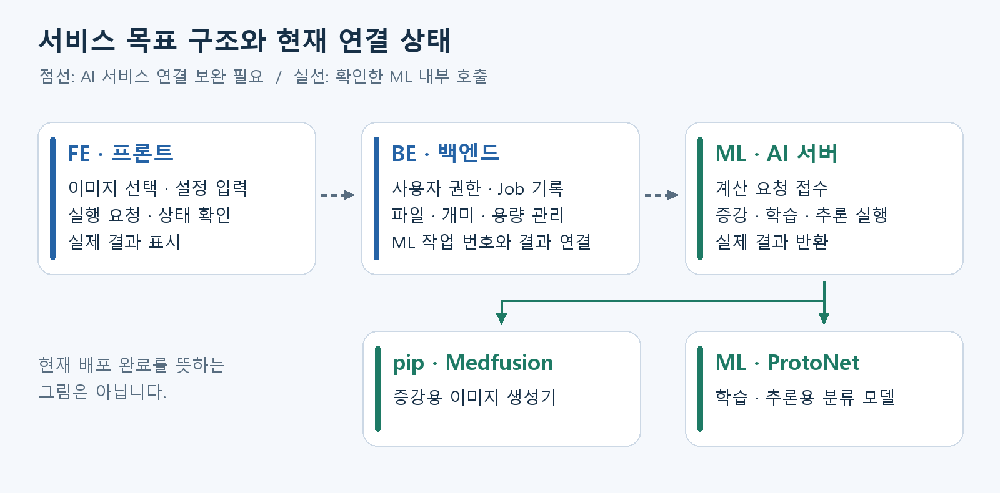
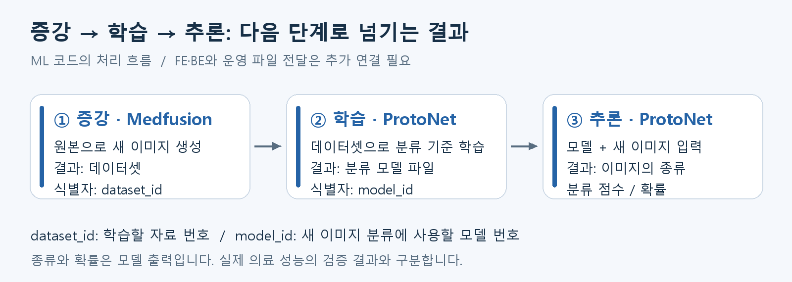

# BIFUSION AI 연동 — 팀 공유 및 실행 계획

> **2026.10.12 코드 조사 기준.** 실제 GPU 실행은 아직 시험 전입니다.
>
> 목표: **실제 이미지로 증강 → 학습 → 추론을 끝내고, 화면을 새로고침해도 같은 결과를 다시 볼 수 있게 하기.**

## 먼저 알아둘 현재 상태

- **ML:** 증강·학습·추론 코드와 API가 있습니다. 실제 모델 파일과 GPU 환경에서 실행 검증이 필요합니다.
- **FE:** 최신 설정과 실제 결과를 연결해야 합니다. 일부 요청 실패가 모의 작업으로 바뀌는 경로가 남아 있습니다.
- **BE:** AI 실행·파일·작업 상태·결과 기록을 묶는 연결이 필요합니다.
- **이번 순서:** 실행 재료 확보 → GPU 시험 → 증강 → 학습·추론 → 화면 연결 → 레시피·자원 정책 → QA.

이 자료에서 **확인**은 코드에서 확인한 사실, **할 일**은 추가 구현, **결정**은 팀 합의가 필요한 항목입니다.

## 서비스 구조를 먼저 이해하기

- **FE(프론트엔드):** 사용자가 이미지와 설정을 입력하고 결과를 보는 화면.
- **BE(백엔드):** 사용자 권한·프로젝트·작업 기록·개미·파일을 관리하는 서버.
- **ML(AI 서버):** 실제 이미지 생성과 분류 계산을 수행하는 서버.
- **API:** 프로그램끼리 요청하고 답을 받는 통로.
- **Job:** 사용자가 실행한 계산 한 건. 증강 한 번, 학습 한 번이 각각 Job입니다.

그림의 **점선은 추가 연결이 필요한 AI 서비스 관계**, **실선은 확인한 ML 내부 호출 관계**입니다.

ML은 증강에 **Bifusion_pip의 Medfusion 생성기**를 쓰고, 학습·추론에는 **ML 자체 ProtoNet**을 씁니다. pip 저장소의 다른 실험 기능이나 모델 파일을 웹 서비스와 그대로 호환된다고 보면 안 됩니다.

- **Medfusion:** 원본 이미지에 맞춰 새 이미지를 만드는 생성 모델.
- **ProtoNet:** 이미지의 특징을 각 종류의 대표 특징과 비교해 분류하는 모델.
- **Bifusion_pip:** 여기서는 ML이 가져다 쓰는 Python 코드 저장소의 이름입니다.

---

## 작업 1. AI를 실행할 재료와 RunPod 준비

**목표:** 모델 파일을 읽고 GPU에서 실제 계산할 수 있는 환경 확보.

### 준비할 것 — ML 중심, FE 함께 확인

- ML의 **Medfusion 브랜치**, pip의 **version-Med 브랜치**.
- 외부 **medical_diffusion 코드의 정확한 버전**.
- **VAE·Diffusion 체크포인트 2개**와 파일 위치.
- 입력 이미지와 두 종류가 뜻하는 실제 의미.
- GPU 종류, 보존할 디스크, 예상 사용시간, 종료 담당자.

**체크포인트/가중치**는 모델이 학습한 숫자를 저장한 파일입니다. 코드가 계산 방법이라면 가중치는 학습된 내용입니다. 코드만 받아서는 생성기를 실행할 수 없습니다.

**RunPod**는 GPU 컴퓨터를 빌리는 서비스이고, **Pod**는 그 컴퓨터의 실행 환경입니다. **GPU**는 AI의 많은 계산을 빠르게 수행하는 장치입니다.

### 실행할 때 확인할 것

- Python이 GPU를 인식하는지 확인한 뒤, 작은 실제 GPU 연산까지 실행합니다.
- 모델 파일을 메모리에 읽는 **로딩**이 성공하는지 확인합니다.
- 첫 시험은 **작업자 한 개**가 증강·학습·추론을 순서대로 처리하게 합니다.
- API 서버와 작업자가 같은 결과 파일 위치를 사용하게 합니다.
- 공개 접속 전 인증을 구성하고, 저장장치의 보존·과금 조건을 확인합니다.

**API 서버**는 요청 접수 담당입니다. **Redis**는 작업 대기열, **Celery 작업자**는 대기열에서 일을 꺼내 계산하는 프로그램입니다. 작업자 세 개를 각각 하나씩 켜면 계산 세 개가 동시에 실행될 수 있습니다.

### 완료 기준

- [ ] 실제 GPU 연산 성공.
- [ ] 외부 코드와 두 모델 파일의 버전·위치 확인.
- [ ] 모델 로딩 성공.
- [ ] 전체 GPU 계산이 한 번에 하나씩 실행됨.
- [ ] 결과 저장 위치와 Pod 종료 후 보존 조건 확인.

**GPU 속도·메모리·비용은 실측 후 공유합니다.** 기존 배포 문서의 성능 수치를 이번 조사에서 재현한 것은 아닙니다.

---

## 작업 2. 실제 원본으로 증강하기

**목표:** 원본과 설정을 보내 실제 새 이미지와 데이터셋을 만들기.

**증강(Augmentation)**은 원본을 바탕으로 새 이미지를 추가하는 단계입니다. 정상 5장·비정상 5장을 올리고 종류별 10장을 생성하면 새 이미지가 합계 20장 추가됩니다.

### FE 입력값과 ML 이름 맞추기

| 화면 항목 | ML 요청 이름 | 설명·기본값 |
|---|---|---|
| 종류별 추가 생성 수 | num_samples_per_class | 각 종류를 몇 장씩 새로 만들지. 기본 10 |
| 원본 변화 강도 | strength | 낮으면 원본과 비슷하고 높으면 변화가 커질 수 있음. 기본 0.3, 범위 0~1 |
| 추가 학습 횟수 | finetune_steps | 생성기를 내 원본에 맞추는 반복 횟수. 서버 코드 기본 400 |
| 생성 단계 | steps | 이미지를 만드는 계산 단계 수. 서버 코드 기본 50 |
| 시드 | seed | 무작위 계산의 시작값. 재실행 설정에 기록 |

**파인튜닝(Fine-tuning)**은 이미 학습된 생성기를 내 이미지에 맞춰 추가 조정하는 과정입니다. 다음 작업의 분류 모델 학습과 목적이 다릅니다.

**시드(Seed)**를 같게 하면 재현하기 쉬워지지만, 모델·환경까지 영향을 받습니다. 동일한 결과를 항상 보장한다는 문구는 피합니다. 400·50도 배포 설정에 따라 바뀔 수 있으므로 실제 적용값을 저장합니다.

### 각 담당이 할 일

- **FE:** 원본의 실제 내용을 전달하고 위 입력 항목을 반영합니다.
- **BE:** 업로드 파일의 소유자·형식·크기를 확인하고 ML 입력으로 변환합니다.
- **ML:** 입력 범위를 검증하고 실제 파일과 데이터셋 번호를 반환합니다.

**권장 업로드 흐름:** FE 파일 업로드 → BE의 fileId 발급 → Job에 fileId 전달 → BE가 승인된 파일을 읽어 ML로 전달.

**fileId**는 서버 파일의 번호입니다. 현재 ML은 fileId가 아니라 **Base64 이미지 배열**을 받습니다. Base64는 파일을 문자열로 표현하는 방식이며, 전송량이 대략 4/3로 늘어납니다. 위 변환은 추가 연결이 필요합니다.

### 팀이 결정할 제한

- 종류별 최소·최대 입력 장수와 최대 추가 생성 수.
- 파일당 용량, 전체 요청 용량, 최대 픽셀 크기.
- JPG/PNG 등 허용 형식과 원본 비율 처리 방식.

**확인:** FE는 종류별 최소 5장입니다. 배포 문서는 최대 업로드 10장·최대 생성 100장을 적었지만 ML 검증은 강제하지 않습니다. BE 일반 업로드 제한은 파일당 10MB·요청 합계 50MB입니다. 10MB 파일 20장을 한 번에 보내는 방식과 맞지 않습니다.

현재 원본은 128×128로 줄여 처리합니다. 크게 다시 확대해도 원본의 세부 정보가 복원되는 것은 아니므로 해상도·비율 정책도 정해야 합니다.

### 시안 반영과 완료 기준

팀원의 HTML 시안은 최신 방향과 맞습니다. 다음 문구만 다듬습니다.

- “원본 충실도” → **원본 변화 강도**
- “값이 높을수록 품질이 오릅니다” → **계산 횟수를 조절하며, 시간이 늘 수 있습니다**
- “동일한 이미지를 다시 생성합니다” → **같은 시드와 설정으로 재현하기 쉽게 합니다**

- [ ] 실제 원본이 전달되고 기대한 수의 새 이미지 생성.
- [ ] 완료 결과에서 dataset_id와 파일 확인.
- [ ] 사용자 설정과 실제 실행 설정 일치.
- [ ] 제한 초과·손상된 이미지에 명확한 오류 표시.

**이전 설정 주의:** sampling_steps·guidance_scale·model_name은 최신 증강 요청에서 제거됐습니다. 모르는 필드는 오류 없이 무시될 수 있어 성공 응답만으로 설정 적용을 판단하지 않습니다.

---

## 작업 3. 증강 결과로 학습하고 새 이미지 분류하기

**목표:** 위에서 만든 자료와 모델을 다음 단계가 실제로 이어받기.

### 학습 입력

| 입력 | 뜻 | ML 기본값 |
|---|---|---|
| dataset_id | 완료된 증강 자료를 찾는 번호 | 실제 결과에서 선택 |
| k_shot | 사례마다 종류별로 참고하는 이미지 수 | 5 |
| q_query | 사례마다 종류별로 분류 연습에 쓰는 이미지 수 | 5 |
| epochs | 큰 학습 반복 단위 | 30 |
| episodes_per_epoch | 반복 단위 안에서 학습 사례를 구성하는 횟수 | 10 |
| seed | 자료를 뽑는 무작위 시작값 | 42 |

**Support**는 참고 이미지, **Query**는 그 참고 자료로 맞혀 보게 하는 이미지, **Episode**는 이 둘을 뽑아 구성한 사례 한 번입니다.

예를 들어 K-shot=3, Q-query=5면 종류별 참고 3장·연습 5장으로 사례를 만듭니다. Epoch당 이 사례를 10번 구성하는 식입니다. 데이터가 부족하면 현재 코드가 중복 추출할 수 있으므로 필요한 자료 수를 검증해야 합니다.

- **FE:** 완료된 실제 데이터셋을 선택하게 합니다. 별도 Query 업로드를 필수로 요구하지 않습니다.
- **BE:** dataset_id와 원본 증강 Job을 연결해 저장합니다.
- **ML:** 학습을 완료하고 model_id와 모델 파일을 반환합니다.

외부 Query 이미지·정답을 별도로 올려 평가하는 기능은 추후 지원입니다. 현재 점수는 **데이터셋 내부 검증 결과**로 설명합니다.

### 추론 입력과 결과

**추론(Inference)**은 학습된 모델에 새 이미지를 넣어 분류하는 단계입니다.

- 실제 **model_id**와 새 이미지 내용을 보냅니다.
- 반환된 NORMAL/ANOMALY와 확률을 표시합니다.
- **Confidence**는 모델의 분류 점수입니다. 의료적으로 그만큼 정확하다는 의미가 아닙니다.
- 예시 모델 목록·고정 정확도·검수 완료 표시를 실제 결과로 교체합니다.

### 파일 전달에서 해결할 문제

**S3**는 클라우드 파일 보관함이고, **로컬**은 계산 서버의 디스크입니다.

현재 ML은 S3에 결과를 올리는 코드가 있지만 후속 학습·추론은 로컬 파일을 찾습니다. **S3 저장과 다음 단계의 읽기를 함께 연결해야 합니다.** 첫 Pod 시험은 같은 로컬 결과 위치로 흐름을 확인합니다.

### 완료 기준

- [ ] 실제 증강 dataset_id로 학습 성공.
- [ ] 실제 학습 model_id로 추론 성공.
- [ ] 입력 이미지 수만큼 결과 반환.
- [ ] 다음 단계에서 결과 파일을 실제로 읽음.

**시험 데이터 주의:** pip의 bloodmnist_binary는 림프구·호중구 데이터입니다. 정상·질환 데이터로 설명하지 않습니다.

---

## 작업 4. FE·BE를 실제 Job으로 연결하기

**목표:** 실행·대기·완료·실패를 같은 작업 기록으로 추적하기.

### 최소 API 합의

| 기능 | 합의할 내용 |
|---|---|
| 업로드 | 기존 /api/v1/files/temp 재사용 여부, fileId와 소유권 |
| 실행 | 증강·학습·추론 구분, 파일·설정 전달 방식 |
| 상태·결과 | BE Job ID와 ML job_id 연결, 상태·결과 응답 |
| 목록·다운로드 | 실제 완료 목록, 사용자 권한, 만료 URL 재발급 |
| 삭제 | 실행 중·다른 작업이 사용 중인 파일의 처리 |

### ML에 이미 있는 실행·조회 주소

| 작업 | 시작 요청 | 상태·결과 조회 |
|---|---|---|
| 증강 | POST /augmentation/run | GET /augmentation/{job_id} |
| 학습 | POST /training/run | GET /training/{job_id} |
| 추론 | POST /inference/run | GET /inference/{job_id} |

**POST**는 시작 요청, **GET**은 조회입니다. {job_id}에는 시작 응답에서 받은 실제 번호를 넣습니다. 이 주소는 ML용이며, FE가 호출할 BE 주소와 구분합니다. /health는 API 응답 확인용으로 모델 로딩 성공까지 확인해 주지는 않습니다.

실행 경로를 /jobs/augment처럼 나누거나, 일반 /jobs에서 type으로 구분할 수 있습니다. **주소는 새로 합의할 내용이며, 이미 구현된 것으로 보지 않습니다.** 조사한 BE JobController에서는 댓글 API가 확인됐습니다.

**DTO**는 요청·응답의 이름과 형식을 정한 틀입니다. 화면의 “생성 단계 50”을 ML의 steps: 50으로 변환하는 것처럼, FE·BE·ML의 값과 이름을 맞춰야 합니다.

### 실행 후 화면 동작

1. BE가 파일·권한·비용·공간을 확인하고 Job을 기록합니다.
2. ML에 계산을 요청하고 ML 작업 번호를 연결합니다.
3. FE에는 Job 번호와 대기 상태를 반환합니다.
4. FE가 일정 간격으로 상태를 확인합니다.
5. 성공하면 실제 결과, 실패하면 이유를 표시합니다.

바로 작업 번호를 받고 계산은 나중에 끝내는 방식을 **비동기 처리**, 일정 간격으로 “끝났나요?”를 묻는 것을 **폴링**이라고 합니다.

### 상태 표시

- PENDING → 대기
- STARTED / RUNNING → 실행 중
- SUCCESS → 성공
- FAILED → 실패

회의 결정대로 **진행률 바·%는 제거하되 상태 조회는 유지**합니다. 파일 저장 전에 100%가 나올 수 있으므로 퍼센트만으로 성공 처리하지 않습니다.

현재 ML에 취소 API가 없으므로 취소 성공처럼 표시하지 않습니다. FE의 모의 성공과 고정 결과도 실제 연동 확인 단계에서 제거하거나 명확히 구분합니다.

### 완료 기준

- [ ] 재접속·새로고침 후 같은 Job과 결과 조회.
- [ ] 실패 요청이 가짜 성공으로 바뀌지 않음.
- [ ] 중복 클릭·재시도가 GPU 작업을 중복 생성하지 않음.
- [ ] 실제 파일을 권한 있는 사용자가 다운로드 가능.

같은 요청을 반복해도 생성·차감을 한 번만 하는 성질을 **멱등성**이라고 합니다. 요청마다 식별값을 붙여 중복 실행을 막는 방식입니다.

---

## 작업 5. 레시피 실행과 개미·저장 용량 연결

**목표:** 재사용할 설정, 실행 비용, 실제 파일 사용량을 일치시키기.

### 포크 레시피에서 증강

**포크(Fork)**는 다른 사람 레시피를 내 사본으로 가져오는 것입니다. 레시피는 설정 기록이므로 원본 이미지 선택도 필요합니다.

**내 사본 → 내 프로젝트 → 원본 이미지 → 설정 수정 → 비용 확인 → 증강 Job 생성** 순서로 연결합니다.

- BE 레시피 저장 형식에 최신 strength·finetune_steps·steps·생성 수를 반영합니다.
- 실제로 바꿀 수 없는 모델명·샘플러·해상도 등을 자유 선택처럼 표시하지 않습니다.
- 원본 레시피 ID와 당시의 최종 실행 설정을 저장합니다.

당시 설정의 사본을 **스냅샷**이라고 합니다. 원본 레시피가 나중에 바뀌어도 지난 Job의 기록은 유지돼야 합니다.

### 개미와 리워드

- ML은 계산, BE는 잔액·비용·보상 기록을 관리합니다.
- 실행 전 예상 비용 안내 → 잔액 예약 → 합의한 시점에 차감·정산.
- 포크 비용과 증강 실행 비용, 실패·취소의 환급 조건을 정합니다.
- Q&A·검수·포크 보상의 지급 조건과 중복 지급 방지를 정합니다.

기존 BE에는 검수 신청 시 포인트 차감과 승인/거절 완료 시 전문가에게 보상의 90%를 지급하는 경로가 있습니다. 새 정책과 일치하는지 확인합니다. **가격은 아직 책정하지 않았고 현금화는 범위에 넣지 않습니다.**

### 저장 용량과 삭제

- 프로젝트 수는 무제한입니다.
- 고정 저장량이 사용자별인지 팀별인지 결정합니다.
- 파일별 소유자·Job·실제 바이트·사용 관계를 기록합니다.
- 시작 전 공간을 예약하고 완료 후 실제 크기로 정산합니다.
- 다른 학습·추론이 사용하는 파일은 삭제 정책을 먼저 확인합니다.
- 실제 파일 삭제 성공 뒤 사용량을 줄입니다.

**쿼터(Quota)**는 허용 저장량입니다. Job을 목록에서 숨기는 것만으로 실제 파일 용량이 줄지는 않습니다. 삭제로 공간이 줄어드는 것과 이미 사용한 GPU 비용 환급은 별도입니다.

### 완료 기준

- [ ] 포크 설정과 선택한 원본으로 실제 증강 실행.
- [ ] 최종 설정·가격표 버전·차감 내역 추적 가능.
- [ ] 중복 차감·보상 방지.
- [ ] 화면 용량과 실제 파일 기록 일치.
- [ ] 삭제 시 다른 작업의 파일 사용 관계 확인.

---

## 작업 6. QA와 회의에서 확정할 사항

**QA**는 사용 흐름이 기대한 대로 작동하는지 확인하는 시험입니다.

### 첫 통합 시험

- 정상·비정상 각 5장 정도를 준비합니다.
- 증강은 생성 각 2장, 추가 학습 2회, 생성 단계 5로 작게 시험합니다.
- 학습은 K-shot=1, Q-query=1, Epoch=1, 사례 수=1로 시험합니다.
- 그 모델로 새 이미지를 분류합니다.

이 설정은 **연결 확인용**입니다. 품질 평가나 대표 속도 측정값으로 발표하지 않습니다. 성공 뒤 실제 운영 후보 설정으로 다시 측정합니다.

### 페이지별 QA 기록

| 시험할 것 | 확인할 결과 |
|---|---|
| 올바른 원본·설정 | 실제 파일과 결과 생성 |
| 제한 초과·손상된 이미지 | 실행 전 오류 안내 |
| 중복 클릭·통신 재시도 | 한 번만 실행·차감 |
| 실행 중 새로고침 | 같은 Job의 상태 유지 |
| 실패·모델 파일 누락 | 명확한 실패, 모의 성공 없음 |
| 포크 후 설정 수정 | 수정한 최종값으로 실행 |
| 파일 다운로드·삭제 | 권한·만료·용량·참조 관계 확인 |

### 팀이 먼저 결정할 다섯 가지

- **실행 재료:** 외부 코드 버전, 모델 파일, GPU 환경.
- **입력 규칙:** 장수·용량·픽셀·생성/학습 상한.
- **API 계약:** 업로드·실행·상태·결과의 형식.
- **자원 정책:** 고정 용량의 소유 단위, 개미 차감·환급·보상.
- **역할과 일정:** 각 작업의 구현 담당·검증 담당·완료일.

회의록 일정은 RunPod 공부 10/12 → 피드백 10/13, QA 양식·페이지 계획 10/17입니다. **이는 계획이며 완료 보고가 아닙니다.**

## 조사 기준과 참고

- ML: Medfusion / ffd687b
- pip: version-Med / 3675ae6
- FE: main / ac0cdb3
- BE: main / b967864, develop / a7825f2
- Python 59개 파일 문법·구조, 요청 검증 19개 사례, 설정 전달·이미지 변환 확인.
- 실제 RunPod GPU 실행·가중치 로딩·성능·비용 측정은 미실시.

[ML 코드](https://github.com/NoDataNoLife/BIFUSION-ML/tree/ffd687b) · [pip 코드](https://github.com/NoDataNoLife/Bifusion_pip/tree/3675ae6)

제품 방향은 **소량 이미지의 증강 실험을 레시피로 재사용하고, 전문가 검토와 후속 분류 실험으로 연결하는 협업 서비스**입니다. 시연에서도 예시 점수보다 실제 원본·실행 설정·결과·검토 기록을 보여주는 데 집중합니다.
